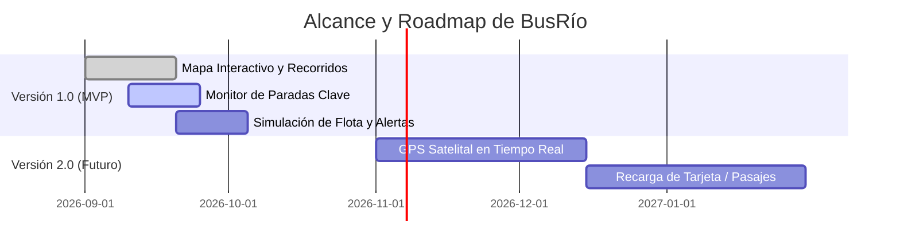

# 🚌 Documento de Investigación y Propuesta de Proyecto: "BusRío"
**Evaluación Final Integradora (E.F.I.) - Movilidad y Transporte Urbano**  
**Ciudad de Río Cuarto, Córdoba, Argentina**

---

## 1. 📌 Resumen de la Idea

### Contexto y Problemática Local
En la ciudad de Río Cuarto, las paradas de transporte público con alta afluencia de pasajeros —tales como **Plaza Roca (Centro)**, el **Hospital San Antonio de Padua**, la **Universidad Nacional de Río Cuarto (UNRC)** y los nodos principales de **Banda Norte** y **Barrio Alberdi**— presentan constantes complicaciones operativas. Los usuarios sufren demoras severas, falta de previsibilidad en las frecuencias, cambios repentinos de recorridos sin previo aviso por obras o manifestaciones, y escasa información durante horarios pico o fines de semana.

### Solución Propuesta: "BusRío"
**BusRío** es un monitor interactivo y progresivo (PWA - Progressive Web App) diseñado para la ciudadanía de Río Cuarto. La aplicación tiene un único objetivo primordial: **mostrar dónde están los colectivos en este momento**. Permite consultar en tiempo real y desde cualquier dispositivo:
* Mapa de OpenStreetMap con recorridos georreferenciados y unidades en movimiento.
* Tiempos de arribo y estado operativo de cada línea (normal, demorada o desviada).
* Líneas favoritas para acceso rápido y frecuente.
* Funciones de accesibilidad (visibilidad de unidades adaptadas con rampa), modo claro y oscuro, modo Tótem para salas de espera y modo de ahorro de datos móviles (Low-Data Mode).
* Plan Premium con alertas de llegada configurables, favoritos ilimitados, recorridos guardados ("Mis recorridos") y nivel de ocupación de las unidades en vivo.

---

## 2. 🏢 Datos de la Empresa

### Datos Principales
* **Nombre Comercial / Razón Social**: `BusRío Tech S.A.S.` (Tecnologías de Movilidad Río Cuarto S.A.S.)
* **Domicilio Físico**: Calle Constitución 645, Piso 3, Oficina 302, X5800 Río Cuarto, Córdoba, Argentina.
* **Teléfono de Contacto**: +54 (0358) 465-9800
* **Correo Electrónico Oficial**: `contacto@busrio.com.ar` / `soporte@busrio.com.ar`
* **CUIT**: 30-71829450-4
* **Sitio Web Oficial**: `https://www.busrio.com.ar`

> [!NOTE]
> **Datos ficticios con fines académicos:** CUIT, teléfono, domicilio físico y casillas de correo electrónico han sido generados exclusivamente con fines didácticos para la formulación de la presente E.F.I.

### ¿A qué se dedica la empresa?
`BusRío Tech S.A.S.` es una empresa de base tecnológica especializada en **Sistemas Inteligentes de Transporte (ITS)**, desarrollo de software urbano y soluciones de experiencia ciudadana. Diseñamos herramientas digitales orientadas a ciudades intermedias del interior argentino, mejorando la interacción entre los ciudadanos, el transporte público y las decisiones de infraestructura urbana.

### ¿Ya tiene un sitio o aplicación?
Actualmente, existe un prototipo funcional listo para desplegar en **Vercel** o **Netlify**, estructurado en formato **PWA (Progressive Web App)**. La aplicación está optimizada tanto para ejecutarse directamente desde navegadores modernos en smartphones y computadoras de escritorio, como para ser instalada en la pantalla de inicio con carga instantánea y funcionamiento offline básico.

---

### 🎨 Identidad Visual y Formatos de Logo

#### Paleta Cromática y Tipografía Oficial
* **Paleta Institucional**: 
  * **Ámbar Institucional** (`#F59E0B` / hover `#D97706`): Color principal de identidad, acentos de tránsito y telemetría activa.
  * **Fondo Oscuro / Superficie**: Gradiente pizarra (`#0F172A` a `#020617`) con bordes contrastantes (`#334155`), asegurando legibilidad nocturna y bajo consumo energético.
* **Sistema Tipográfico**:
  * **Títulos y Cabeceras**: `Outfit` (estética moderna, geométrica y de alto impacto visual).
  * **Cuerpo de Texto y Contenidos**: `Plus Jakarta Sans` (excelente legibilidad en pantallas de alta y baja densidad).
  * **Datos Numéricos, Métricas y ETA**: `Fira Code` (fuente monoespaciada para tiempos de arribo, frecuencias y códigos de línea).

#### Icono para Apps y Tiendas (Favicon / App Icon)
* **Concepto Visual e Isotipo Real (`/icons/icon.svg`)**: 
  * Silueta geométrica con bordes suavemente redondeados (**Squircle**, `rx="108"`) con fondo en gradiente oscuro slate (`#0F172A` a `#020617`) y trazo exterior protector (`#334155`).
  * Ondas concéntricas superiores de señal GPS en color ámbar institucional (`#F59E0B`) con opacidad graduada, simbolizando la conectividad satelital en vivo.
  * Vista frontal de un colectivo urbano estilizado en degradé ámbar vibrante (`#F59E0B` a `#D97706`), con parabrisas panorámico oscuro (`#0F172A`), destello de cristal en celeste (`#38BDF8`), faros frontales duales (blanco con núcleo `#FEF08A`), rejilla de ventilación y ruedas inferiores.
* **Dimensiones y Especificaciones**:
  * `iOS / Android App Icon`: 512x512 px (PNG 32-bit sin transparencia para tienda).
  * `Favicon Web`: Multi-resolución (16x16, 32x32, 192x192, 512x512 px en `.png` y `.svg`).

#### Logo en Diferentes Formatos
1. **Isotipo (Icono de Marca)**: Formato `.svg` vectorial escalable (`/icons/icon.svg`) para aplicaciones móviles, favicon y cabecera del monitor.
2. **Logotipo (Texto de Marca)**: Tipografía `Outfit Bold`, combinando "Bus" en texto principal y "Río" en ámbar institucional (`#F59E0B`).
3. **Isologotipo / Imagotipo Completo**: Isotipo del colectivo con ondas GPS a la izquierda acompañado de "BusRío - Monitor Urbano" a la derecha, para encabezados web y pie de página.
4. **Variantes Tecnológicas Exportadas**:
   * `SVG Vectorial`: Máxima nitidez y cero distorsión responsive.
   * `PNG Fondo Transparente`: Para superposición en mapas, cartelería y banners (Alta Res 300 DPI).
   * `Versión Dark Mode`: Fondo oscuro slate (`#0F172A`), texto blanco puro y acentos de atención en ámbar institucional (`#F59E0B`).

---

## 3. 👥 Funcionalidades por Tipo de Usuario

| Tipo de Usuario | Acceso / Modalidad | Funcionalidades Principales |
| :--- | :--- | :--- |
| **Usuario General** *(Plan Gratuito)* | Abierto y directo desde cualquier navegador | • Mapa en vivo con seguimiento de unidades en movimiento. • Trazado de recorridos georreferenciados sobre OpenStreetMap. • Tiempos de arribo y estado por línea (normal, demorada o desviada). • Hasta 3 líneas o paradas favoritas. • Modos Claro y Oscuro. • Modo Tótem para salas de espera. • Modo Ahorro de Datos (Low-Data Mode). • Filtro de unidades accesibles (rampa/piso bajo). • Publicidad discreta sobre el mapa (propuesta, ver modelo de negocio). |
| **Usuario Premium** *(Simulado)* | Activación simulada desde modal de planes | • Alertas de llegada con 2, 5 o 10 minutos de anticipación (aviso en pantalla y notificación del navegador). • Favoritos ilimitados. • Sección "Mis recorridos" para guardar y consultar combinaciones frecuentes. • Nivel de ocupación de los colectivos en vivo (Vacío, Medio o Lleno). • Navegación limpia 100% sin publicidad. |
| **Administrador** | Acceso protegido con usuario y contraseña | • Panel administrativo de control de flota y servicio. • Modificación en tiempo real del estado de cada línea (normal, demorada o desviada). • Pausar o reanudar unidades en circulación. • Ajuste interactivo de velocidad de simulación (x1, x5, x10). • Botón de restablecimiento de datos de demostración a valores de fábrica. |

> [!NOTE]
> **Aclaración técnica:** En esta versión del proyecto, tanto el acceso de administrador como el plan Premium son simulaciones ejecutadas íntegramente del lado del cliente mediante almacenamiento local (`localStorage`), sin requerir autenticación de servidor ni cobros monetarios reales. En una etapa productiva comercial, se requerirá un backend seguro con autenticación de usuarios y una pasarela de pagos digital integrada como Mercado Pago.

---

## 4. ⚙️ Requerimientos de Software (Frontend) & Justificación Técnica

### 1. Framework / Herramienta CSS: **Tailwind CSS (v3)**
* **Justificación Técnica**:
  * **Prototipado Rápido y Compilación a Producción**: En la etapa actual de MVP se utiliza Tailwind CSS v3 vía CDN para garantizar agilidad y velocidad en el prototipado de interfaces. En una fase de producción final, la hoja de estilos se compilaría mediante el motor JIT (Just-In-Time) de Tailwind (vía CLI o bundler como Vite/PostCSS), purgando selectivamente las clases no empleadas y reduciendo el CSS final resultante a unos pocos KB.
  * **Estrategia Mobile-First Nativa**: Permite adaptar tableros y mapas complejos a pantallas móviles pequeñas de manera fluida mediante prefijos responsive (`sm:`, `md:`, `lg:`).
  * **Soporte Nativo de Dark Mode**: Implementación directa por clase CSS (`dark:`), ideal para usuarios que consultan horarios de noche o en paradas con baja iluminación.

### 2. Librería de Mapeo Interactiva: **Leaflet.js + OpenStreetMap**
* **Justificación Técnica**:
  * Cero costo por licencias API (a diferencia de Google Maps API que cobra por render de mapa).
  * Carga asíncrona ligera (peso menor a 40 KB) sin bloquear el hilo principal de ejecución.
  * Permite personalizar marcadores de paradas (Plaza Roca, Hospital, UNRC) y trazar polígonos de recorridos con colores distintivos por línea.

### 3. Hosting Propuesto y Costos

| Proveedor | Plan Recomendado | Características | Costo Estimado |
| :--- | :--- | :--- | :--- |
| **Vercel / Netlify** *(Principal)* | Hobby (Vercel) / Free (Netlify) | Despliegue continuo desde GitHub, CDN global, HTTPS automático y soporte nativo PWA. | **\$0 USD / mes** (Gratuito para la etapa académica del MVP) |
| **Cloudflare Pages** *(Backup)* | Free Tier | Protección DDoS ilimitada y distribución ultra rápida Edge. | **\$0 USD / mes** |
| *Escala Futura (Producción)* | Pro Plan | Netlify Pro: USD 20/mes con miembros ilimitados y 3.000 créditos. Vercel Pro: USD 20/mes por asiento, con USD 20 de crédito de uso. | USD 20 / mes (consultado el 27/10/2026 en netlify.com/pricing y vercel.com/pricing) |

> Nota: los planes gratuitos de hosting sirven para el prototipo académico. Al incorporar publicidad y suscripciones, el uso pasa a ser comercial y corresponde un plan de pago.

### 4. Dominio Web y Costo (NIC Argentina)
* **Dominio Elegido**: `busrio.com.ar` (y reserva de `busrio.ar`).
* **Entidad Registrante**: NIC Argentina (`nic.ar`).
* **Costo de Registro y Renovación Anual**: `.com.ar` $8.500 ARS y `.ar` $25.500 ARS (alta, renovación anual y transferencia). Valores consultados el 27/10/2026; verificar en nic.ar antes de la entrega.

---

## 5. 📲 Social Media & Canales Corporativos

1. **Correo Corporativo (Google Workspace / Gmail)**:
   * `busrio.riocuarto@gmail.com` / `contacto@busrio.com.ar`
2. **Facebook Empresarial**:
   * `https://facebook.com/BusRioOficial` (Página verificada para difusión masiva a usuarios de mediana y mayor edad en Río Cuarto).
3. **Instagram Empresarial**:
   * `@busrio.rc` (`https://instagram.com/busrio.rc`) (Infografías de desvíos, novedades de frecuencias para estudiantes universitarios).
4. **Canal de YouTube**:
   * `https://youtube.com/@BusRioOficial` (Video-tutoriales de uso de la PWA, explicativos de combinaciones de líneas y trasbordos).
5. **Google Form / Feedback Integrado**:
   * Formulario embebido en la aplicación para recibir sugerencias de horarios, reportes de infraestructura y comentarios de experiencia de uso.

---

## 6. 💎 Valor Agregado de la Propuesta

¿Qué tiene **BusRío** que el cliente o ciudadano **NO** encuentra en opciones gratuitas estándar como Google Maps o Moovit?

1. **Monitoreo Directo y Especializado en Río Cuarto**:
   * Información concentrada específicamente en el esquema del transporte local y sus paradas clave (Plaza Roca, Hospital, UNRC, Centro de Trasbordo).
2. **Optimización de Consumo de Datos (Low-Data Mode)**:
   * Funciona fluidamente incluso con conexiones 3G débiles cerca del río o en zonas periféricas, reduciendo notablemente el consumo de datos móviles frente a mapas pesados.
3. **Matriz de Trasbordos y Boleto Combinado Local**:
   * Calculador adaptado a la reglamentación local de Río Cuarto (ventana de tiempo para trasbordo gratuito o bonificado entre líneas urbanas).
4. **Modo Monitor de Parada para Pantallas Físicas (Tótem)**:
   * Permite ser proyectado en salas de espera (ej. Hospital San Antonio de Padua, locales comerciales frente a Plaza Roca), convirtiendo cualquier televisor o tablet en una pantalla informativa en vivo.
5. **Filtro Estricto de Accesibilidad**:
   * Permite visibilizar unidades que cuentan con rampa para sillas de ruedas o piso bajo adaptado.

---

## 7. 🎯 Alcance del Proyecto

### ✅ Incluido en la Primera Versión (V1 - MVP)
* **Mapa Interactivo**: Trazado visual de recorridos georreferenciados y seguimiento de unidades en circulación.
* **Monitor de Paradas Críticas**: Tiempos calculados y cuenta regresiva de arribo en paradas clave (Plaza Roca, Hospital, UNRC).
* **Gestión de Estado de Línea**: Indicadores visuales de servicio (Normal, Demora, Desvío).
* **Buscador Inteligente**: Filtrado dinámico por número de línea, nombre de ramal y garita.
* **Soporte PWA Instalable**: Funcionamiento multiplataforma (Android, iOS, PC).
* **Modo Oscuro / Claro**: Selección automática y manual adaptada al entorno.
* **Modo Tótem & Low-Data**: Pantalla completa para terminales y ahorro de ancho de banda.
* **Simulación Premium & Admin**: Alertas de llegada, favoritos ilimitados, recorridos y panel administrativo en cliente.

### ❌ NO Incluido en la V1 (Reservado para Versión 2.0 / Futuras Iteraciones)
* Integración hardware por telemetría GPS directa con la prestataria de colectivos (requiere convenio institucional con la empresa concesionaria).
* Pasarela de cobro bancario o recarga de saldo de boleto urbano.
* Cobertura de servicios interurbanos provinciales (ej. Río Cuarto - Holmberg - Las Higueras).
* Módulo de reserva de asientos o viajes a demanda.

---

## 8. 📋 Detalle de Contenidos y Características

1. **Módulo Mapa & Recorridos**:
   * Selector dinámico por Línea (ej. Línea 1, Línea 2, Línea 8, etc.).
   * Visualización interactiva con capas y polilíneas georreferenciadas con colores distintivos por ramal.
2. **Módulo Monitor de Parada**:
   * Tarjetas informativas con cuenta regresiva estimada de llegada por línea.
   * Indicador visual de estado de tráfico: `Normal (Verde)`, `Demora (Amarillo)`, `Desvío (Rojo)`.
3. **Módulo de Plan Premium**:
   * Alertas de llegada configurables (2, 5 o 10 min), lista de favoritos ilimitada, gestión de "Mis recorridos" y ocupación en vivo.
4. **Módulo de Guía de Trasbordo**:
   * Sugerencia de combinaciones de líneas para traslados desde barrios hacia el Hospital o la UNRC.
5. **Sección Institucional & Equipo**:
   * Presentación de la empresa `BusRío Tech S.A.S.`, visión de impacto local y formulario de contacto.

---

## 9. 💼 Modelo de Negocio

El modelo de negocio de **BusRío** contempla dos fuentes de ingresos estratégicas y complementarias:

### a) Publicidad sobre el Mapa (Plan Gratuito)
Comercios, instituciones y marcas locales de la ciudad de Río Cuarto publicitan dentro del mapa en vivo:
* **Formatos publicitarios**:
  * **Marcadores patrocinados**: Ubicados cerca de las paradas más transitadas (por ejemplo, una cafetería junto a Plaza Roca o una librería cerca de la UNRC). Al hacer clic sobre el marcador, se abre un popup con el nombre del comercio y su oferta o beneficio del día.
  * **Banner discreto**: Situado en el borde del mapa, asegurando que no tape en ningún momento a los colectivos en movimiento ni los trazados de recorridos.
* **Condiciones de visualización y respeto al usuario**: Se identifica de manera explícita con la etiqueta **"Publicidad"**, no interfiere jamás con la información de los colectivos y solo se muestra en el plan gratuito.
* **Segmentación geográfica**: Cada anunciante aparece cerca de su zona de influencia territorial, asegurando la máxima relevancia para el vecino que se desplaza por ese sector.

### b) Suscripción Premium
Plan de pago mensual orientado a usuarios frecuentes del transporte público que valoran la puntualidad y una experiencia de consulta avanzada:
* **Prestaciones exclusivas**: Alertas de llegada con 2, 5 o 10 minutos de anticipación (mediante avisos en pantalla y notificaciones del navegador), favoritos ilimitados para paradas y líneas, sección "Mis recorridos", indicador de ocupación de las unidades en vivo (Vacío, Medio o Lleno) y navegación 100% libre de anuncios publicitarios.

### c) Relación entre Ambas Fuentes
La relación entre ambos esquemas es sinérgica: la **publicidad financia el servicio gratuito** haciéndolo accesible para cualquier ciudadano sin barreras de entrada, mientras que la **Suscripción Premium** se posiciona como la alternativa de valor superior, libre de avisos y con herramientas avanzadas de anticipación y personalización.

> [!NOTE]
> **Aclaración del prototipo:** En el prototipo actual, la publicidad (propuesta conceptual para una versión futura) y el plan Premium son simulaciones del lado del cliente, sin pasarela de pagos ni anunciantes reales activos.

> [!IMPORTANT]
> **Esquema tarifario propuesto (estimación propuesta por el equipo, a validar):**
> * **Suscripción mensual Plan Premium**: **\$3.600 ARS / mes** (estimación propuesta por el equipo, a validar).
>   * *Criterio explícito*: Equivalente a 2 viajes en colectivo por mes (`2 × $1.800`, valor del boleto urbano vigente en Río Cuarto, [fuente y fecha de consulta a completar por el equipo]). Un usuario diario realiza unos 40 viajes por mes, por lo que la suscripción representa alrededor del 5% de su gasto mensual en transporte, un costo bajo frente al valor que recibe, sin que el servicio dependa de la publicidad.
> * **Tarifas para Anunciantes Locales**:
>   * **Marcador patrocinado en mapa (geolocalizado)**: **\$[tarifa base a definir] ARS / mes** por ubicación comercial (estimación propuesta por el equipo, a validar).
>     * *Criterio explícito y justificación*: Orientado a comercios y servicios de proximidad (cafeterías, librerías, farmacias). El monto se calcula en función de la zona y afluencia de pasajeros de la parada contigua (con mayor tarifa en paradas de alto tránsito como Plaza Roca o UNRC frente a nodos barriales secundarios). Fórmula propuesta: `[tarifa base por parada] × [coeficiente de afluencia de la zona]`.
>   * **Banner publicitario en el mapa**: **[k] × tarifa base del marcador patrocinado (con k mayor que 1)** (estimación propuesta por el equipo, a validar).
>     * *Criterio explícito y justificación*: Tarifa superior a la del marcador individual, justificada por su alcance global dentro de toda la plataforma, su exposición permanente sobre la interfaz y su impacto visual continuo ante la totalidad de los usuarios del plan gratuito en toda la ciudad.
> 
> *Valores a validar con anunciantes locales.*

---

## 10. 👥 Equipo de Trabajo

A los clientes e instituciones les genera confianza ver a las personas detrás del proyecto. El equipo fundador de **BusRío** está compuesto por:

 

| Miembro | Cargo | Foto / Avatar | Descripción Profesional |
| :--- | :--- | :--- | :--- |
| **Lucas Molina** | Co-Founder & Lead Frontend / UI-UX Engineer |  | Estudiante avanzado de desarrollo de software con amplia experiencia en arquitectura Frontend, TailwindCSS y diseño de sistemas interactivos. Responsable de la experiencia visual, usabilidad móvil y mapa interactivo. |
| **Tadeo** | Co-Founder & Head of Product / Backend Developer |  | Especialista en lógica de negocios, estructuración de datos de transporte urbano, APIs y estrategias de monetización B2B/B2G. Lidera el procesamiento de horarios, paradas y modelo de datos. |

---

### 📌 Conclusión y Próximos Pasos
Este documento establece las bases operativas, técnicas y estratégicas para el desarrollo y despliegue del proyecto **BusRío** en la ciudad de Río Cuarto. Con una base sólida en TailwindCSS, un mapa liviano sobre Leaflet, y un enfoque centrado en la previsibilidad de los colectivos en tiempo real, BusRío resuelve de forma directa una necesidad crítica de movilidad urbana local.
